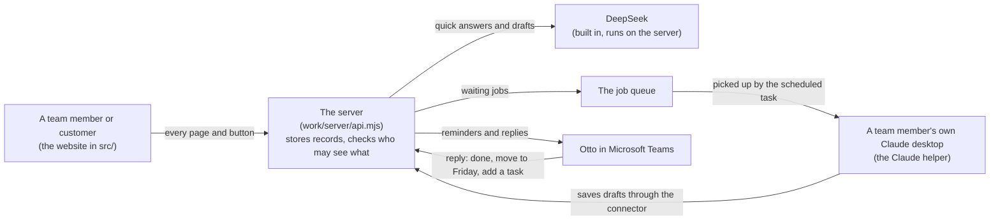

# Facilio Delivery Studio

**In one sentence:** the place where a Facilio team runs a customer project from the signed contract to hand-over, with AI drafting the paperwork and people deciding what is true.

Live app: https://facilio-delivery-studio.facilio.work (sign in with your Facilio Microsoft account).

## What it does, in plain words
A customer project has eight stages. The Studio follows them in order and keeps everything in one record, so nothing is lost between emails, spreadsheets and meetings.

| Stage | What happens | Typical paper that comes out |
|---|---|---|
| 1. Project introduction | Read the signed contract, plan the project, run the kick-off | Project plan, kick-off deck |
| 2. Requirement sessions | Workshops with the customer; AI reads the recordings | Requirements, use cases, open questions |
| 3. Solution design and BRD | Agree the solution for each module; customer signs off online | Business requirements document (BRD) |
| 4. UAT and FTR | Customer tests; every test links to a requirement | Test plan, test results, FTR workbook |
| 5. Training guides | Write the guides the customer's staff will use | User guides, walkthroughs |
| 6. Go-live | Check readiness, switch on | Go-live checklist |
| 7. Hypercare | Support closely for the first weeks | Hypercare reports |
| 8. Project handover | Hand to the support team and close | Handover pack, closure report |

**How AI is used:** AI (DeepSeek, built in, and Claude through the person's own Claude app) writes first drafts from the project's own records. A draft is never final until a person approves it, and nothing is sent to a customer by itself.

**Who uses it:** the Facilio delivery team (full access to their projects) and customers (a limited view of their own project: sign-offs, questions, tests).

## How the pieces fit together

The website draws the pages; the server keeps the records and decides who may see them. Quick answers come from the records or from DeepSeek straight away. Bigger work (a BRD, a guide, a handover pack, importing a plan) goes into a **job queue** and is done by **Claude on a team member's own computer**. Everything Claude writes comes back as a **draft** that a person reads and approves.

## The things that make it feel alive
| What | In plain words | Where to read more |
|---|---|---|
| **Assistant chat** | A panel on the right of every project page. You type a question; simple ones are answered at once from the records, work is sent to Claude, and a live card shows what was asked, how long it has waited and what Claude is doing. | [src/assistant.js](src/assistant.js), [docs/plans/](docs/plans/README.md) |
| **Claude helper** | A small scheduled task in a team member's Claude desktop app does the waiting jobs and starts the morning reminders. The light in the top bar is green while any teammate's Claude is running it and amber when none is. | [docs/integrations/](docs/integrations/README.md), [work/server/_helper.mjs](work/server/_helper.mjs) |
| **Otto in Teams** | A bot that sends each person their tasks and the plan milestones that are due, tells a new project member what they were added to, and takes replies ("T-4 done", "move to Friday", "add a task") that update the Studio. | [docs/integrations/](docs/integrations/README.md) |
| **Guide me** | A guided walk through every stage and page, started once for each person. | [src/coach.js](src/coach.js) |
| **Documents and exports** | The BRD, workshop plan, FTR report, status reports and guides open as pages and export to Word, Excel, HTML and PDF. | [src/README.md](src/README.md) |

## New here? Read in this order
1. This page, to the end: what the product is and where things are.
2. [CHANGELOG.md](CHANGELOG.md): what was added, version by version, in plain words.
3. [docs/README.md](docs/README.md): the six core documents, in reading order.
4. [docs/ROADMAP-REQUIREMENTS.md](docs/ROADMAP-REQUIREMENTS.md): what is built, what is pending and what comes next.
5. The guide of the folder you want to work in: [src](src/README.md), [work](work/README.md), [tests](tests/README.md).

## Where do I find...?
| I want to... | Go to |
|---|---|
| Understand what the product is for and why | [docs/01-product-requirements.md](docs/01-product-requirements.md) |
| See what changed, version by version | [CHANGELOG.md](CHANGELOG.md) |
| See what is built and what comes next | [docs/ROADMAP-REQUIREMENTS.md](docs/ROADMAP-REQUIREMENTS.md) |
| Read how a feature was planned | [docs/plans/](docs/plans/README.md) |
| See how the screens should look | [docs/design/](docs/design/README.md) |
| Learn how Claude, Outlook and Teams connect | [docs/integrations/](docs/integrations/README.md) |
| Read an audit or a review | [docs/reports/](docs/reports/README.md) |
| Deploy the app, or see every past deploy | [docs/operations/](docs/operations/README.md) |
| Find the code behind a page | [src/README.md](src/README.md) (grouped by stage) |
| Find the server code | [work/README.md](work/README.md) |
| Run or understand the tests | [tests/README.md](tests/README.md) |

## The folders
| Folder | What is inside, in plain words |
|---|---|
| `docs/` | All the written documents: the six core documents, the roadmap, plans, design notes, reports and how-to guides. Start with [docs/README.md](docs/README.md) |
| `src/` | The screens people see (the front end), one file per page, plus the sign-in and opening animations |
| `work/` | The server: the part that stores data, talks to the AI and decides who may see what |
| `tests/` | Automatic checks that the app still works after every change |
| `tools/` | Scripts developers run by hand (they build icons, reference data and animations; they do not run in the app) |
| `public/` | Pictures, logos and files the website serves as they are. See [public/README.md](public/README.md) |
| `vendor/` | Third-party libraries the app uses (PDF, Word, Excel, animation). See [vendor/README.md](vendor/README.md) |
| `data/` | The cleaned-up reference configuration that is built into the app |
| `skills/` | Claude skills for guides and videos |
| `.github/` | The automatic test run on GitHub. See [.github/README.md](.github/README.md) |
| `.claude/` | Settings and shortcuts for Claude sessions (for example the `/deploy` command). See [.claude/README.md](.claude/README.md) |

Files in the top folder: `README.md` (this page), `CHANGELOG.md` (the history: what was added in each version), `CLAUDE.md` (the rules for anyone working here, including Claude), `HANDOFF.md` (what the last working session left behind), `build.mjs` (turns the source into the website), `package.json` (the list of what the project needs).

## For developers
```bash
npm install
node build.mjs                      # builds the website into dist/ (empties it first)
node tests/ui/devserver.mjs 4173    # preview at http://localhost:4173/?nointro
npm test                            # server and logic checks against a pretend platform
```
The site must stay under 50 MB. Deploying goes through the facilio.work connector, see [docs/operations/DEPLOY.md](docs/operations/DEPLOY.md).

## Words you will meet
* **BRD**: business requirements document, the agreed description of what will be built.
* **MSA**: the master services agreement, the signed contract.
* **UAT**: user acceptance testing, where the customer checks it works.
* **FTR**: first-time-right, the checklist workbook for testers.
* **Hypercare**: the close-support period after go-live.
* **Connector**: the link that lets a person's own Claude read and write project records.
* **Otto**: the Teams bot that answers questions about tasks and sends the reminders.
* **Claude helper**: the small scheduled task in a team member's Claude desktop app that does the waiting jobs. The light in the top bar of the app shows whether one is running.
* **Job**: a piece of work a button asks Claude to do (for example drafting the BRD). It waits in a queue until a Claude picks it up.
