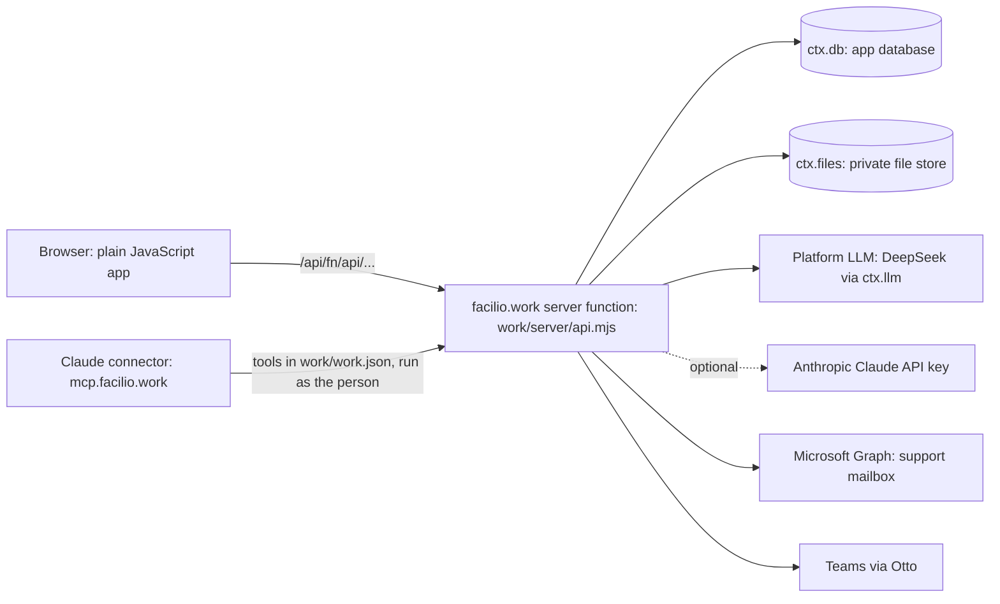

# 2. Technical requirements (TRD)

How Delivery Studio is built and what limits it must respect. What it does is in [01-product-requirements.md](01-product-requirements.md); the data and routes are in [05-backend-schema.md](05-backend-schema.md).

## Architecture


| Layer | Choice |
|---|---|
| Front end | Plain JavaScript in `src/`, no framework. Views register in `FWBViews`; actions are wired with `data-act` and `data-change`. One bundle built by `build.mjs` (esbuild, minified), styles layered in the order listed in `build.mjs` (later layers win; `depthlayer.css` is last) |
| Server | One function, `work/server/api.mjs`, with `_ai.mjs` (AI providers) and `_portfolio.mjs` (admin health). Every route checks identity and project role |
| Page to server | `work/src/workapi.js` sends the app's `/api/*` calls to the function and moves file parts through one-time upload and download links |
| Identity | Microsoft sign-in handled by the platform (`ctx.viewer`); only `@facilio.com` is accepted |
| Data | `ctx.db` collections and `ctx.files`; layout in [05-backend-schema.md](05-backend-schema.md) |
| Reference data | `data/reference-data.mjs` (sanitised baseline) is written to `reference.dat` and `reference-meta.json` at build time |
| Hosting | facilio.work only. The static site and the function are uploaded as one zip through the platform's connector (`/deploy`) |

## AI layer
- Providers (`work/server/_ai.mjs`): **DeepSeek** (platform LLM, text), **Claude** (optional, only when the owner grants `anthropic_api_key`), and an image reader for flow pictures. Which provider serves which operation is configured by an admin (Admin, AI provider).
- Every model answer is untrusted: JSON is parsed and rebuilt field by field against a fixed shape; drafts are saved unapproved.
- Long documents are written part by part (a function has 25 seconds): a job, then each part, then the finished draft; a part that times out is retried once, and a missing section is named instead of failing the document.
- Details: [reference/ai-architecture.md](reference/ai-architecture.md).

## Claude connector
Tools are declared in `work/work.json` and served at `https://mcp.facilio.work/facilio-delivery-studio`. They run as the signed-in person through the same routes as the app, so project access and limits are the app's own. Reads are compact and capped; writes are unapproved drafts. See [reference/claude-connector.md](integrations/claude-connector.md).

## Security
- Access is checked on the server for every request (platform identity, then project membership and role).
- Strict content security policy: scripts only from the app's own origin; the build fails if the template has an inline script.
- No secrets in the browser or in the repository. Credentials are held by the platform (`secrets.facilio.work`) and granted to the app: `graph_mail` (Microsoft Graph, read-only, pinned to `graph.microsoft.com`), `teams_notify`, optional `anthropic_api_key`.
- Per-person rate limits (AI, uploads, writes, tickets, hand-offs, connector); a failing counter never locks people out.
- Uploaded files are checked against their claimed type; hand-off packages expire after one hour and can be read only by the person who made them.
- Customer-visible data excludes team-only kinds (`utc`, `mfind`, `lcstage`, `cal`).

## Privacy
No cookies, no tracking, four functional browser preferences; data is held by the platform; retention limits, data download and deletion requests are in [reference/privacy-and-retention.md](reference/privacy-and-retention.md).

## Limits the design must respect
| Limit | Value | Consequence |
|---|---|---|
| Extracted site size | 50 MB (now about 42 MB, 264 files) | Large libraries live in `vendor/`; check `du -sm dist` before deploy |
| Server function time | 25 seconds | AI work is split into parts; budgets per call |
| Database value | about 128 KB | Records over about 100 KB are gzipped and split into parts |
| Zip upload | 80 MB, 25 MB per file | |
| App review | Pending | Only owner and collaborators can open the app until approved |

## Performance
One request opens a project (`/open`), with indexes and a smaller download; the application bundle is minified; sections open at once because slower data is fetched quietly afterwards. Load and scale checks: `npm run test:load` (100 projects, 100 people, AI limits) and `npm run test:scale`.

## Build, test and deploy
```bash
npm install
node build.mjs              # writes dist/ (empties it first)
node tests/ui/devserver.mjs 4173   # preview at http://localhost:4173/?nointro
npm test                    # server and logic tests against a mock of the platform
```
Browser checks live in `tests/ui/` (Playwright, one file per area; run with `PW_CHANNEL=msedge` when Playwright's own browser is not installed). Deploying is described in [operations/DEPLOY.md](operations/DEPLOY.md); every deploy is logged in [operations/DEPLOYS.md](operations/DEPLOYS.md).

## Browser support and accessibility
Current Chrome and Edge. Interactive elements are real buttons or inputs with labels; tab bars use roles; colours keep readable contrast; motion respects reduced-motion settings.
