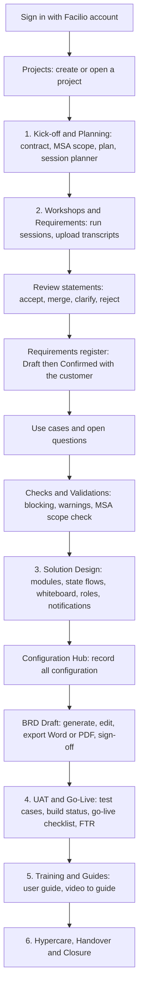
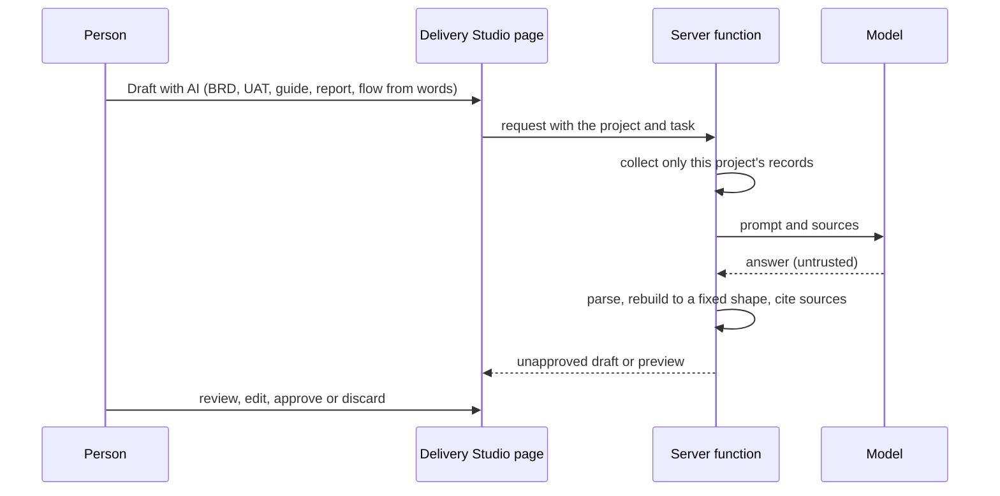
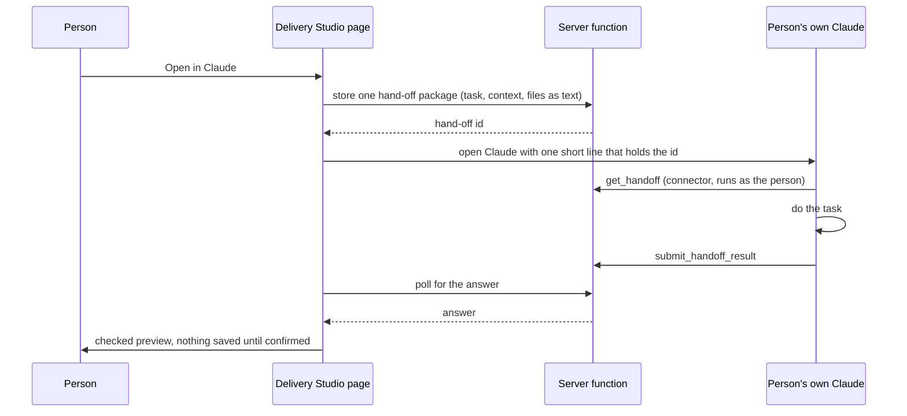

# 3. App flow

How a person moves through Delivery Studio, and how data moves between the pages and the server. The menu names match `src/shell.js`.

## The delivery journey

Alongside every stage: **Project control** (tasks, governance and RAID, change requests, status reports, traceability) and **Support and Tickets**.

## Key flows

### 1. From a workshop to a requirement
1. Upload the transcript (Requirements and Use Cases, Transcripts). It is read in the browser against the configuration; nothing is sent to an outside service.
2. Each statement lands in the review queue. A person chooses Accept, Merge, Clarify or Reject. Accept creates a **Draft** requirement; Clarify creates an open question.
3. After the customer agrees, the requirement is marked **Confirmed**. Only Confirmed requirements reach the BRD.

### 2. BRD
1. Mark modules in scope; confirm requirements; build flows and roles.
2. BRD Draft assembles the document. The team edits text on the page (bold, italic, underline, headings, lists, tables), adds blocks, hides blocks, imports their own BRD (Word, PDF, text) or starts blank, and can delete any BRD.
3. Checks and Validations must show no blocking issue before sign-off. The status moves Draft, In review, Approved (only a project owner or admin can approve).
4. Export to Word or PDF; each export is saved with the project.

### 3. AI draft with a person in control

### 4. Open in Claude and the connector

A person can also ask Claude directly: it uses the connector to read requirements, questions, use cases, tickets and records, and saves finished text with `save_draft` as an unapproved draft.

### 5. Support mailbox and tickets
1. An admin presses **Sync now** (Tickets, Support mailbox). The server reads the mailbox through Microsoft Graph with the read-only `graph_mail` credential.
2. A reply with `[TKT-n]` in the subject joins that ticket. Other mail follows the routing rules; unmatched mail waits in the inbox for an admin to route or dismiss.
3. Client feedback, questions and UAT findings are copied into Tickets when the page opens (once each, linked back to the source). Teams messages become tickets through Otto, after the person reviews type, priority and project.

### 6. Opening a project
The page asks for one request (`/open`) that returns the project, members, the documents it needs and the record kinds it needs. Everything else loads quietly afterwards. Saves go back as document sections with a version number; a conflict is reported rather than overwritten.

## Roles and what they can do
| Role | Can |
|---|---|
| Platform owner | Everything, plus admin screens and access grants |
| Admin | Manage projects and users |
| Sub admin | Read-only admin |
| Project owner | Edit, approve BRD, manage members |
| Editor | Edit project content |
| Viewer | Read |
| Customer | Not enabled yet |
